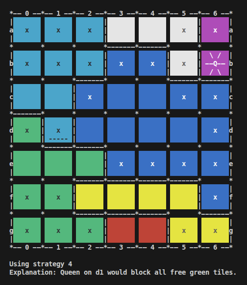

# Queens Helper in Duckling


Program pozwala na:
1. Generowanie zagadek o podanym rozmiarze oraz poziomie trudności.
2. Przeanalizowanie kolejnych kroków prowadzących do rozwiązania wraz z wyjaśnieniem.




## Format wejścia
Przykładowy format zagadki poniżej
```
8
11111333
11112223
11132333
11033343
10033553
00773555
00733656
07766666
```

## Wymagania

Duckling 0.3 ([wydanie v0.3](https://github.com/ducktype-org/duckling/releases/tag/v0.3)). Na Linuksie x86_64:

```bash
curl -fsSLO https://github.com/ducktype-org/duckling/releases/download/v0.3/duckling-0.3-linux-x86_64.tar.gz
tar -xzf duckling-0.3-linux-x86_64.tar.gz
cd duckling-0.3-linux-x86_64 && ./install.py      # instaluje do ~/.local/share/duckling i dopisuje PATH
```

Na innych systemach zbuduj Ducklinga ze źródeł według instrukcji w
[repozytorium języka](https://github.com/ducktype-org/duckling). Sprawdzenie: `duck --version`.

## Budowanie i uruchamianie

```bash
duck build                              # program w .duck_build/dev/my_project
duck run
```

---